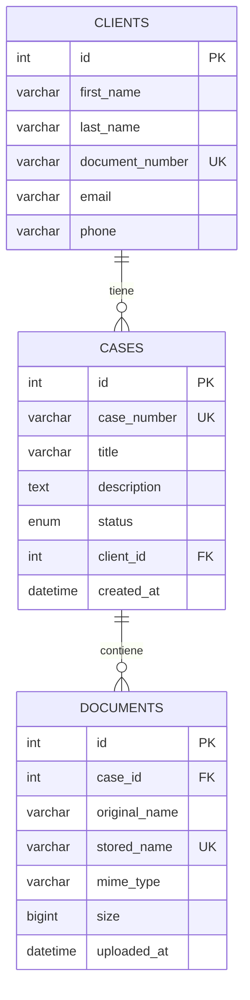

# Sistema educativo de expedientes judiciales

**Especificación funcional y técnica — versión 1.0**  
**Propósito:** enseñar subida, descarga y eliminación de archivos con Multer en una API REST de Node.js.  
**Contexto:** estudio jurídico ficticio; no constituye un sistema para documentación judicial real.

## 1. Objetivos

Construir una API que permita gestionar clientes, expedientes y documentos adjuntos. La complejidad del negocio se reduce intencionalmente para concentrar el tutorial en `multipart/form-data`, `diskStorage`, `single`, `array`, `fileFilter`, límites, manejo de errores y consistencia entre MySQL y disco.

Los alumnos podrán seguir el código paso a paso a través del tutorial que se irá creando en README.md a medida que se construyan las especificaciones definidas de manera incremental. Además del tutorial detallado, se irán agregando comentarios más acotados en el propio código fuente para reforzar la comprensión de los conceptos.

## 2. Stack tecnológico

| Capa | Tecnología |
| --- | --- |
| Runtime | Node.js |
| HTTP | Express |
| Lenguaje | JavaScript con ES Modules |
| Base de datos | MySQL |
| ORM | Sequelize |
| Validación de datos | Zod |
| Gestión de archivos | Multer |
| Persistencia de archivos | Sistema de archivos local (`uploads/`) |
| Pruebas manuales | Postman, Bruno u otro cliente HTTP |

## 3. Alcance

### Incluido

- Crear, listar, consultar y editar clientes.
- Crear, listar, consultar y editar expedientes.
- Cambiar el estado de un expediente entre `OPEN` y `CLOSED`.
- Subir un documento o hasta cinco documentos por lote.
- Listar los documentos de un expediente.
- Descargar documentos por un endpoint HTTP.
- Eliminar definitivamente documentos y sus archivos físicos.
- Validar MIME declarado, tamaño individual, cantidad y tamaño acumulado.
- Manejar errores y limpiar archivos cuando falla una subida.

### Excluido

- Autenticación, autorización, usuarios y roles.
- Frontend, almacenamiento en la nube y exposición pública de `uploads/`.
- Eliminación de clientes o expedientes.
- Versionado de documentos, auditoría, notificaciones y actuaciones procesales.
- Detección de archivos duplicados por hash.
- Verificación de contenido mediante *magic bytes* o análisis antimalware.
- Integración con sistemas judiciales reales.

## 4. Modelo de datos



### `clients`

| Columna | Tipo MySQL | Restricciones / finalidad |
| --- | --- | --- |
| `id` | `INT UNSIGNED` | PK, autoincremental |
| `first_name` | `VARCHAR(100)` | NOT NULL |
| `last_name` | `VARCHAR(100)` | NOT NULL |
| `document_number` | `VARCHAR(20)` | NOT NULL, UNIQUE; DNI/CUIT representado como texto |
| `email` | `VARCHAR(150)` | Opcional; validar formato si se informa |
| `phone` | `VARCHAR(30)` | Opcional |

### `cases`

| Columna | Tipo MySQL | Restricciones / finalidad |
| --- | --- | --- |
| `id` | `INT UNSIGNED` | PK, autoincremental |
| `case_number` | `VARCHAR(50)` | NOT NULL, UNIQUE |
| `title` | `VARCHAR(200)` | NOT NULL; carátula |
| `description` | `TEXT` | Opcional |
| `status` | `ENUM('OPEN','CLOSED')` | NOT NULL; por defecto `OPEN` |
| `client_id` | `INT UNSIGNED` | NOT NULL, FK a `clients.id` |
| `created_at` | `DATETIME` | NOT NULL; fecha de creación |

### `documents`

| Columna | Tipo MySQL | Restricciones / finalidad |
| --- | --- | --- |
| `id` | `INT UNSIGNED` | PK, autoincremental |
| `case_id` | `INT UNSIGNED` | NOT NULL, FK a `cases.id` |
| `original_name` | `VARCHAR(255)` | NOT NULL; nombre enviado por el cliente |
| `stored_name` | `VARCHAR(255)` | NOT NULL, UNIQUE; UUID + extensión |
| `mime_type` | `VARCHAR(100)` | NOT NULL; MIME declarado |
| `size` | `BIGINT UNSIGNED` | NOT NULL; bytes |
| `uploaded_at` | `DATETIME` | NOT NULL; fecha de subida |

Las relaciones son `clients 1:N cases` y `cases 1:N documents`. Un cliente o expediente puede existir sin entidades hijas. No se requiere un `UNIQUE` sobre `original_name`: varios documentos pueden compartir nombre original, incluso dentro del mismo expediente.

**Decisiones de implementación a mantener coherentes:** si Sequelize gestiona marcas de tiempo automáticamente, mapearlas explícitamente a `created_at` / `uploaded_at` o desactivar las adicionales. No utilizar eliminación en cascada para borrar archivos físicos: los endpoints de eliminación de clientes y expedientes no existen.

## 5. Contrato de la API

Prefijo común: `/api`. Las peticiones y respuestas de entidades, salvo subida y descarga, usan JSON.

### Clientes

| Método | Ruta | Operación | Éxito |
| --- | --- | --- | --- |
| `POST` | `/api/clients` | Crear cliente | `201` |
| `GET` | `/api/clients` | Listar clientes | `200` |
| `GET` | `/api/clients/:id` | Consultar cliente | `200` |
| `PATCH` | `/api/clients/:id` | Editar campos informados | `200` |

`POST` requiere `first_name`, `last_name` y `document_number`; `email` y `phone` son opcionales. `PATCH` admite cualquiera de esos campos, con al menos uno presente. `id` no es editable. `document_number` no puede repetirse.

### Expedientes

| Método | Ruta | Operación | Éxito |
| --- | --- | --- | --- |
| `POST` | `/api/cases` | Crear expediente | `201` |
| `GET` | `/api/cases` | Listar expedientes | `200` |
| `GET` | `/api/cases/:id` | Consultar expediente | `200` |
| `PATCH` | `/api/cases/:id` | Editar expediente | `200` |

`POST` requiere `case_number`, `title` y `client_id`; permite `description` y `status` opcionales. El estado inicial es `OPEN` si no se envía otro. `PATCH` permite `case_number`, `title`, `description`, `status` y `client_id`, con al menos un campo. `id` y `created_at` no se modifican. Debe existir el cliente referenciado y `case_number` ha de ser único.

### Documentos

| Método | Ruta | Operación | Éxito |
| --- | --- | --- | --- |
| `POST` | `/api/cases/:id/documents` | Subida individual | `201` |
| `POST` | `/api/cases/:id/documents/batch` | Subida múltiple | `201` |
| `GET` | `/api/cases/:id/documents` | Listar metadatos | `200` |
| `GET` | `/api/documents/:id/download` | Descargar con nombre original | `200` |
| `DELETE` | `/api/documents/:id` | Eliminar registro y archivo físico | `204` |

**Subida individual:** `Content-Type: multipart/form-data`, campo de archivo `document`, middleware `upload.single('document')`, resultado disponible en `req.file`. Devuelve metadatos del documento creado.

**Subida múltiple:** `Content-Type: multipart/form-data`, campo de archivos repetido `documents`, middleware `upload.array('documents', 5)`, resultado en `req.files`. Devuelve la colección de metadatos creados. El lote requiere de 1 a 5 archivos.

**Listado:** devuelve documentos asociados al expediente solicitado; no devuelve bytes del archivo.

**Descarga:** busca `stored_name` en MySQL y utiliza `res.download()` con `original_name` como nombre de descarga. No expone rutas físicas internas.

**Eliminación:** busca el registro, elimina el archivo físico con `fs.unlink()` y, solo si eso tiene éxito, elimina el registro. Devuelve `204` sin cuerpo.

## 6. Reglas de negocio

1. Cada expediente pertenece a un único cliente existente.
2. Cada documento pertenece a un único expediente existente.
3. Clientes y expedientes pueden corregirse con `PATCH`, pero no eliminarse.
4. Los expedientes usan los estados `OPEN` y `CLOSED`; el cambio es reversible.
5. El estado del expediente es informativo: se pueden subir, descargar o eliminar documentos incluso si está `CLOSED`.
6. No se exige que el nombre original de un documento sea único.
7. Cada subida crea un registro independiente y genera un nombre físico nuevo con `crypto.randomUUID()`.
8. Los archivos se guardan en un único directorio `uploads/`; su relación con el expediente depende de MySQL.
9. La extensión física se determina según el MIME admitido, no copiando ciegamente la extensión del nombre recibido.
10. Solo se aceptan los MIME declarados `application/pdf`, `image/jpeg` e `image/png`.
11. Cada archivo puede tener como máximo **5 MB** (`5 * 1024 * 1024` bytes).
12. Cada lote admite como máximo **5 archivos**.
13. El tamaño total de un lote no puede superar **20 MB** (`20 * 1024 * 1024` bytes).
14. Una subida múltiple es de **todo o nada**: si cualquier validación o inserción falla, no deben quedar registros del lote ni archivos de esa operación.
15. Se puede descargar un documento por su ID, utilizando el nombre original del archivo.
16. La eliminación de un documento es definitiva: afecta el archivo físico y el registro de MySQL.

## 7. Multer y almacenamiento

### Configuración conceptual

- `diskStorage.destination`: directorio único `uploads/`.
- `diskStorage.filename`: UUID generado en el servidor, seguido de `.pdf`, `.jpg` o `.png` según MIME.
- `fileFilter`: verifica `file.mimetype` contra la lista permitida y rechaza el resto.
- `limits.fileSize`: `5 * 1024 * 1024`.
- `limits.files`: máximo cinco en el endpoint de lote.
- `single('document')`: procesa una subida individual.
- `array('documents', 5)`: procesa el lote.
- Validación adicional posterior a Multer: suma de `req.files[*].size` y rechazo si excede 20 MB.

Ejemplo de nombres:

```text
uploads/
  550e8400-e29b-41d4-a716-446655440000.pdf
  01d2f7c9-11aa-478e-9121-250a36caf900.jpg
```

Los archivos no se publican mediante `express.static()`. La aplicación debe crear o verificar la existencia de `uploads/` antes de almacenar archivos.

**Advertencia didáctica:** `file.mimetype` es declarado por el cliente y puede ser falsificado; esta validación es suficiente solo para el ejercicio local con archivos ficticios. Una aplicación real requeriría comprobación de contenido y medidas de seguridad adicionales.

## 8. Fallos, consistencia y respuestas

| Caso | Respuesta sugerida | Comportamiento |
| --- | --- | --- |
| ID o datos inválidos | `400 Bad Request` | No ejecutar la operación |
| MIME no permitido | `400 Bad Request` | Rechazar y limpiar archivos del intento |
| Campo de archivo incorrecto o falta archivo | `400 Bad Request` | Rechazar |
| Archivo > 5 MB | `413 Payload Too Large` | Manejar `LIMIT_FILE_SIZE`; limpiar |
| Lote > 20 MB | `413 Payload Too Large` | Limpiar archivos ya escritos |
| Más de 5 archivos | `400 Bad Request` | Manejar `LIMIT_FILE_COUNT`; limpiar |
| Cliente, expediente o documento inexistente | `404 Not Found` | No modificar estado |
| `case_number` o `document_number` duplicado | `409 Conflict` | No modificar estado |
| Archivo físico no disponible al descargar | `404 Not Found` | No enviar datos inexistentes |
| Error interno, de base o de disco | `500 Internal Server Error` | Informar sin exponer rutas internas |

Formato JSON sencillo propuesto para errores:

```json
{
  "error": "FILE_TOO_LARGE",
  "message": "El archivo supera el tamaño máximo permitido",
  "details": null
}
```

### Subida fallida

1. Verificar que el expediente exista, preferentemente **antes** de invocar Multer.
2. Procesar los archivos y validar sus límites individuales.
3. En lotes, verificar el tamaño acumulado.
4. Registrar los metadatos en una transacción de MySQL.
5. Si falla una validación o escritura de MySQL, revertir la transacción y eliminar todos los archivos escritos durante el intento.
6. Si el propio middleware de Multer falla, centralizar la respuesta y comprobar la limpieza de cualquier archivo escrito durante la petición.

**Matiz importante:** MySQL y el disco no comparten una transacción distribuida. El comportamiento «todo o nada» se implementa mediante transacciones de base de datos y acciones compensatorias; no supone atomicidad absoluta frente a una caída abrupta del proceso o del sistema operativo.

### Eliminación fallida

1. Consultar el documento en MySQL.
2. Intentar `fs.unlink()` sobre el nombre físico almacenado.
3. Si falla `unlink`, conservar el registro e informar el error.
4. Si `unlink` tiene éxito, eliminar el registro y responder `204`.

Si MySQL falla después del `unlink`, podría quedar un registro huérfano: se reconoce como limitación pedagógica de la estrategia seleccionada, sin añadir infraestructura compleja para resolverla.

## 9. Criterios de aceptación

- [ ] Se puede crear un cliente y luego corregir cualquiera de sus datos editables.
- [ ] No se pueden registrar dos clientes con el mismo `document_number`.
- [ ] Se puede crear un expediente vinculado a un cliente existente.
- [ ] Se rechaza crear o actualizar un expediente con un cliente inexistente.
- [ ] Se puede editar la carátula, número, descripción, estado o cliente de un expediente.
- [ ] Se puede cerrar y reabrir un expediente.
- [ ] Se pueden adjuntar documentos tanto a expedientes abiertos como cerrados.
- [ ] Una subida individual válida guarda un archivo en `uploads/` y un registro en MySQL.
- [ ] Dos archivos con el mismo nombre original se guardan sin sobrescribirse.
- [ ] Una subida válida de hasta cinco documentos registra todos los metadatos.
- [ ] Se rechaza un PDF/JPG/PNG declarado con MIME no permitido.
- [ ] Se rechaza un archivo que exceda 5 MB.
- [ ] Se rechaza un lote de más de cinco archivos.
- [ ] Se rechaza un lote que exceda 20 MB aunque ningún archivo individual exceda 5 MB.
- [ ] Si falla la subida de un lote, no quedan archivos ni registros creados por ese intento, en condiciones normales de ejecución.
- [ ] Se pueden listar los documentos asociados a un expediente.
- [ ] Se puede descargar un documento conservando su nombre original.
- [ ] `uploads/` no está expuesto públicamente con `express.static()`.
- [ ] Se puede eliminar un documento y su archivo físico.
- [ ] La eliminación falla sin borrar el registro cuando `fs.unlink()` no puede completarse.
- [ ] Los errores de Multer devuelven respuestas HTTP comprensibles.

## 10. Secuencia didáctica propuesta

1. **Modelo y CRUD:** Express, Sequelize, asociaciones `1:N`, Zod y endpoints de clientes/expedientes.
2. **Subida individual:** `multipart/form-data`, `diskStorage`, `req.file`, UUID y metadatos en MySQL.
3. **Subida múltiple:** `upload.array()`, `req.files`, filtros, límites y errores.
4. **Consistencia y ciclo de vida:** límite acumulado, transacciones, compensación, descargas y borrado físico.

## 11. Convenciones y límites conscientes

- El término «expediente» es una representación educativa simplificada; no refleja toda la complejidad procesal.
- Los tamaños de 5 y 20 MB se entienden en la implementación como MB (potencias de 1024), siguiendo las expresiones acordadas.
- No se especifican paginación, filtros avanzados ni ordenamientos especiales: quedan fuera del alcance.
- El formato exacto de los JSON de éxito puede definirse durante la implementación, manteniendo consistencia entre endpoints.
- No utilizar documentación ni archivos judiciales reales en las pruebas.

---

**Estado:** alcance y decisiones funcionales acordados para el tutorial. La implementación queda a cargo del docente.
